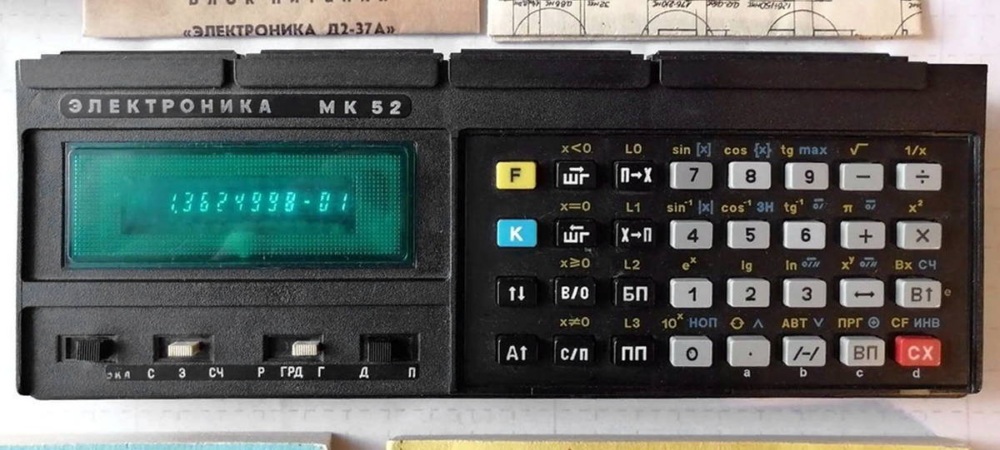
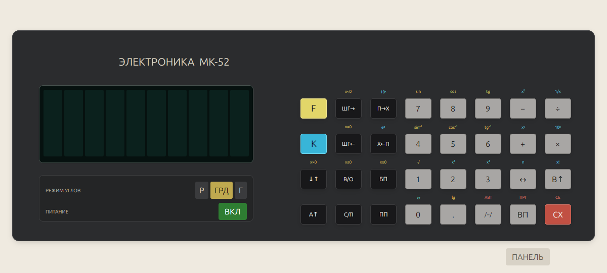

# Эмулятор «Электроника МК-52»

Цикло-точный эмулятор советского программируемого калькулятора «Электроника МК-52».
Проект состоит из независимого ядра на Rust и нативного GUI на GPUI Kit.

## Внешний вид

GUI повторяет горизонтальный корпус оригинала: ВФД слева, физическая клавиатура
8 × 4 справа, цветовые группы клавиш и дополнительные надписи, как на фотографии
калькулятора.

### Оригинал



> На фотографии — оригинальный МК-52, послуживший образцом для пропорций корпуса,
> расположения органов управления и оформления клавиатуры.

### Окно эмулятора



> Скриншот GUI: горизонтальный корпус, ВФД, клавиатура 8 × 4, цвета клавиш
> и блок управления под дисплеем.

## Текущий статус

- **Ядро (`mk52_core`)**: собирается, unit- и интеграционные тесты проходят.
- **GUI (`mk52_gui`)**: собирается через `gpui-kit`; главное окно оформлено как
  горизонтальный калькулятор `1200 × 541`.
  - ВФД из 10 разрядов слева, с бирюзовым свечением.
  - Физическая клавиатура `8 × 4` (32 клавиши): `F`, `K`, `ШГ→`, `П→Х`,
    `ШГ←`, `Х←П`, `↓↑`, `В/О`, `БП`, `A↑`, `С/П`, `ПП`, цифры, арифметика,
    `↔`, `В↑`, `ВП`, `СХ`.
  - Цвета клавиш соответствуют оригиналу: `F` — золотая, `K` — голубая,
    функциональные — чёрные, цифровые и арифметические — серебристые,
    `СХ` — красная.
  - Над клавишами отображаются дополнительные функции: `x<0`, `x=0`, `x>0`,
    `sin`, `cos`, `tg`, `sin⁻¹`, `cos⁻¹`, `tg⁻¹`, `1/x`, `10ˣ`, `x²`, `√`,
    `lg`, `π`, `x!`, `АВТ`, `ПРГ`, `СЕ` и другие.
  - Переключатель режима углов `Р / ГРД / Г` и кнопка питания `ВКЛ / ВЫКЛ`
    расположены под дисплеем.
  - Панель разработчика скрыта по умолчанию и открывается отдельной кнопкой
    `ПАНЕЛЬ`; она показывает FSM, регистры, память, ВФД и управляет паузой,
    турбо-режимом, пошаговым исполнением и программой.
  - Физическая клавиатура отображается как 8 × 4, а события клавиш
    преобразуются в логическую матрицу ядра 10 × 5. Служебные адреса `В/О`
    (пауза) и `С/П` (пуск/стоп) сохранены.
- Подробный план и статус этапов: [`docs/plan.md`](docs/plan.md).

## Структура

```
mk52_core/          # ядро эмулятора: КС, ГП, АЛУ, ВПУ, кольцо, ПЗУ, EEPROM, периферия
  src/
    clock.rs            # системный контроллер, фазы M1..M4, цикл 588 тактов
    cpu_main.rs         # главный процессор (ГП)
    cpu_aux.rs          # вспомогательный процессор (ВПУ), клавиатура, ВФД
    alu.rs              # арифметический процессор, BCD-арифметика
    ring.rs             # кольцевая шина и регистры
    regfile.rs          # регистровый файл
    memory_controller.rs# арбитраж доступа к кольцу
    rom.rs              # ПЗУ микрокоманд
    eeprom.rs           # энергонезависимая память
    program.rs          # формат «МК-52 text»
    lib.rs              # Machine — интеграция компонентов
  tests/                # интеграционные тесты
mk52_gui/           # GUI на gpui-kit
  src/
    backend.rs          # фоновый поток эмуляции и каналы событий
    calculator_view.rs  # горизонтальное окно калькулятора, клавиатура и панель разработчика
    snapshot.rs         # текстовые представления DebugSnapshot
    base_converter.rs   # перевод систем счисления для панели
docs/
  plan.md                   # план доработки и журнал статусов
  architecture.md           # архитектура, карта памяти и матрица точности
  scale_1200.png            # фотография-образец оригинала
  gui.png                   # скриншот окна эмулятора
  Руководство пользователя.pdf
```

## Сборка и тесты

```bash
# всё workspace
cargo test

# конкретный крейт
cargo test -p mk52_core
cargo check -p mk52-gui
cargo run -p mk52-gui
```

Требования: Rust 1.85+ (edition 2024), Linux/macOS/Windows. Для сборки GUI на Linux
нужны dev-пакеты X11/Wayland/fontconfig (см. `.github/workflows/ci.yml`).

## Документация

- [`docs/plan.md`](docs/plan.md) — этапы, критерии готовности, текущий статус.
- [`docs/architecture.md`](docs/architecture.md) — устройство, карта кольца, точность.
- [`docs/Руководство пользователя.pdf`](docs/Руководство%20пользователя.pdf) —
  руководство пользователя МК-52.
- [`docs/scale_1200.png`](docs/scale_1200.png) — фотография оригинала, по которой
  воспроизведён внешний вид GUI.
- [`docs/gui.png`](docs/gui.png) — скриншот окна эмулятора.
- `Проектирование эмулятора Электроника МК-52.pdf` — исходное исследование архитектуры.

## Лицензия

См. [`LICENSE`](LICENSE).
